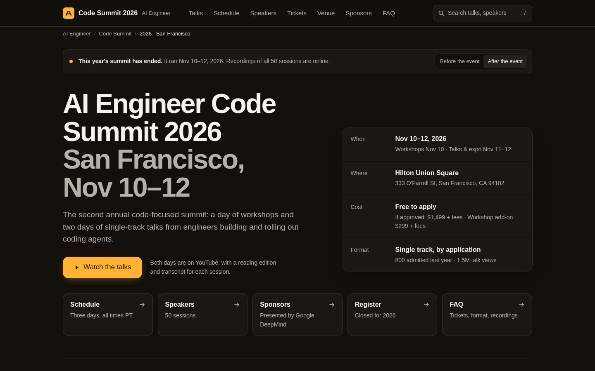

# AIE Code Summit 2026 — rebuild mockup

A static, self-contained redesign of https://ai.engineer/code/2026 driven by the
spec Rehearsal generated for the goal "find the conference schedule"
([docs/sample-spec.md](../../docs/sample-spec.md); there is no `docs/runs/ai.engineer/` on main).

Open `index.html` directly in a browser. No build step, no network requests: CSS,
JS and icons are inline, fonts use the system sans stack. All copy (dates, venue,
prices, talk titles, speakers, sponsors) comes from the live page as fetched on
2026-11-13; no speaker names are invented.

## Spec finding → design change

| Spec finding (docs/sample-spec.md) | Change in the mockup |
| --- | --- |
| 1. Assertion failed in browser: url-matches "schedule" | `Schedule` is a primary nav item and an endpoint card that land on an on-page `#schedule` section with the 2026 three-day agenda (Tue Nov 10 – Thu Nov 12), plus a "Full 2026 schedule" link to `/code/2026/schedule`. |
| 2. Post-event page still invites registration | A status notice states the summit ended Nov 10–12, 2026. After the event, the single above-fold CTA becomes "Watch the talks", the Register card reads "Closed for 2026", and ticket prices are labelled "for reference". A "Before the event / After the event" toggle shows the pre-event variant, where the one dominant CTA is "Register". |
| 3. Dense link surface increases scan cost | ~400 competing links collapse to a 7-item nav (Talks, Schedule, Speakers, Tickets, Venue, Sponsors, FAQ), one primary button, and a 5-item endpoint strip (Schedule / Speakers / Sponsors / Register / FAQ). Secondary links (all sessions, floorplan, sponsor inquiry) sit in section headers. |
| Rebuild plan: single dominant CTA above the fold | Exactly one filled button above the fold; everything else is a text link or card. |
| Rebuild plan: rebuild nav to ~7 items max | Primary nav has 7 items; the current section is underlined as you scroll. |
| Truth pass: copy must match reality | h1 states the page purpose ("AI Engineer Code Summit 2026 — San Francisco, Nov 10–12"); the facts panel gives date, venue, cost ("Free to apply; $1,499 + fees if approved") and format above the fold, answering the cost question without scrolling. |

Trunk test (Krug): page name in the header and h1, breadcrumbs as "you are here",
sticky section nav with the current section marked, and a search field (`/` to
focus) that filters the main-stage talks.

## Notes

- Dates: the live site says Nov 10–12, 2026 (workshops Nov 10, talks Nov 11–12),
  so the mockup uses that rather than Nov 11–13.
- Talks and speakers show a main-stage subset; links point to the live site for the full 50 sessions.
- Motion: one hero entrance (opacity + 8px rise, 60 ms stagger), scale-on-press
  for buttons, gated hovers, and an opacity-only fallback under `prefers-reduced-motion`.
