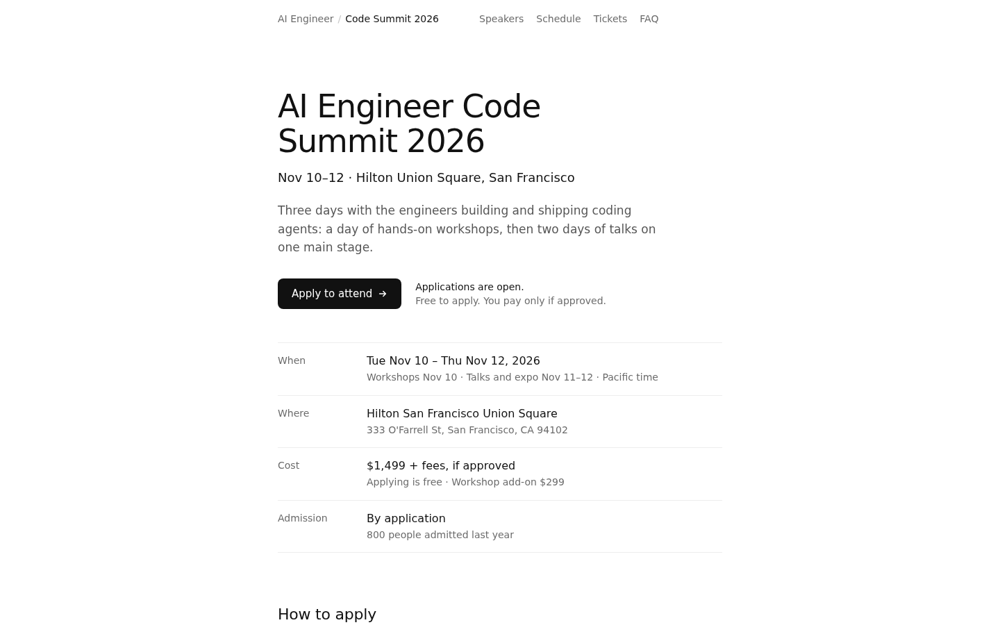
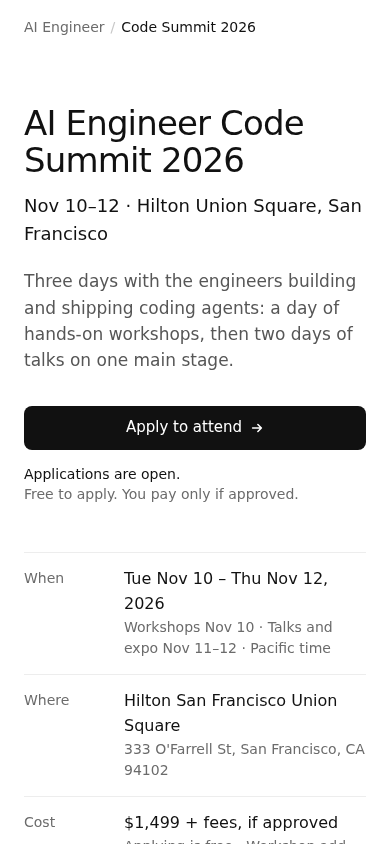

# Code Summit 2026: apply-to-attend mockup

A static redesign of https://ai.engineer/code/2026 aimed at one outcome: more people applying to attend. Open `index.html` in a browser. There is no build step and nothing to install. CSS and JS are inline, fonts come from the system stack, and the only network requests are the outbound links.

The visual language follows alikhani.co: white background, `#111` ink, `#6b6b6b` muted text, `#ededed` hairlines, the `ui-sans-serif` stack, weights 400/500, and a 640px column.

Every fact on the page comes from the live site as fetched on 2026-11-13: dates, venue, prices and the "800 admitted" figure from `/code/2026/apply`, and speakers, talk titles and day structure from `/code/2026/llms.txt`.

Findings below are numbered as in [docs/runs/ai.engineer/spec.md](../../../docs/runs/ai.engineer/spec.md).

## Before and after

| # | Spec finding | Before (live site) | After (mockup) |
| --- | --- | --- | --- |
| 1 | Registration flow is undiscoverable from the landing page | "APPLY TO ATTEND" appears in the text, but no captured link on the landing page points to `/code/2026/apply`. | Four links go straight to `/code/2026/apply`: the hero button, the "How to apply" button, the closing button, and the header "Apply" button. |
| 3, 4 | Browser assertions for the register/confirm URL and confirmation element failed 4 of 4 runs | Runs never reached a registration URL. | Every apply link is a plain `href` to the apply flow, so a run that clicks "Apply to attend" lands on it in one step. The confirmation screen belongs to the apply flow itself and is outside this mockup. |
| 10 | No single dominant call to action; 9 equal-sized actions above the fold | Welcome, Watch & read, Why attend, Apply, Speakers, Program, Venue and Side events are all the same size. | One filled button above the fold ("Apply to attend"). Nothing else on the first screen is a button. The header "Apply" button stays hidden while the hero button is on screen and fades in once it scrolls away. |
| 12, 23 | "How much does it cost?" has no answer path | No price on the landing page or its links. | The cost is in the first screen ("$1,499 + fees, if approved · Applying is free · Workshop add-on $299"), next to the button ("Free to apply. You pay only if approved."), in a Tickets section, and in the FAQ. |
| 5, 14 | Contradictory pre-event and post-event messaging | "Apply to attend" and "First speakers announced" sit beside recordings, livestreams and a schedule "updated Nov 13". | One status line beside the button: "Applications are open." Recordings move to a single FAQ answer and a footer link, so the page has one state. The mockup shows the pre-event state, which is the state where applications can convert. After Nov 12 the same slot would read "Code Summit 2026 has ended" and the button would point to the 2027 list. |
| 9 | Homepage is 16 screens tall | 14,408px at a 900px viewport. | About 3,560px (4 screens) on desktop. The first screen holds the name, dates, venue, cost, admission and the button. Full session lists stay on `/code/2026/schedule` and `/talks`. |
| 8, 11 | 68 nav items; ~400 links per page | Up to 68 visible nav items and 296–523 distinct links per page. | 4 nav items (Speakers, Schedule, Tickets, FAQ) plus Apply. 26 links on the whole page. |
| 2, 13, 17 | Header links on subpages point to World's Fair 2025; "Schedule" means three different things | Home and Schedule on subpages go to `/worldsfair/2025`; homepage "Schedule" reloads a talk-archive toggle. | "AI Engineer" goes to ai.engineer and "Code Summit 2026" goes to the top of this page, so the two homes are labelled separately. Every "Schedule" link points to `/code/2026/schedule`. |
| 6, 7, 22 | Trunk test fails: missing site ID, page name, navigation, you-are-here | No persistent header with these signals on some pages. | A sticky header with site ID ("AI Engineer / Code Summit 2026"), section nav, and the current section highlighted as you scroll (`aria-current`). Search is left out: the page is short enough to scan, and search belongs on the schedule page. |
| 15 | Repeated decorative strings and binary headers | "WELCOME WELCOME WELCOME", "//LOCATION //LOCATION //LOCATION", leading binary digits. | Every label appears once. No decorative text. |
| 16 | Stacked nav bars; three links per talk | Three nav groups on `/talks`; each talk renders three links to the same URL. | One header. Speakers are a name and talk title with no per-talk links; one "All sessions" link covers them. |
| 18 | Developer endpoints compete with attendee tasks | "FOR AGENTS MCP, llms.txt & JSON" sits in the homepage navigation. | llms.txt, Sessions JSON and MCP move to a "For agents" column in the footer. |
| 19, 20, 21 | 3 h1s or no h1; largest text is not the h1 | "A YEAR OF AGENTIC CODING. ONE ROOM." repeated as three h1s. | One h1, "AI Engineer Code Summit 2026", which is also the largest text. Sections use h2, steps use h3. |

## Additions aimed at conversion

- **How to apply** in three steps, taken from the live apply page: share one profile, check the draft, sign with your email. It states the time ("About two minutes") and that nothing is sent until you sign, which lowers the cost of starting. The plain form (`/code/2026/apply/manual`) is linked for people who don't want a drafted application.
- **Admission** line ("By application · 800 people admitted last year") tells visitors the event is selective and that applying is the way in.
- **Speakers**: eight names with their talk titles, so visitors see who they'd hear before deciding.
- **Closing call to action** repeats the date, place, price and time to apply for people who read to the bottom.

## Details

- Motion: one entrance on the hero (6px rise with a 50ms stagger), scale-on-press for buttons, hover effects only on devices with a fine pointer, and transforms removed under `prefers-reduced-motion`.
- Numbers use tabular figures. Focus rings are visible on keyboard focus only.
- On mobile (390px) the nav collapses to the site ID, the hero button goes full width, and the header Apply button appears once the hero button scrolls away.

