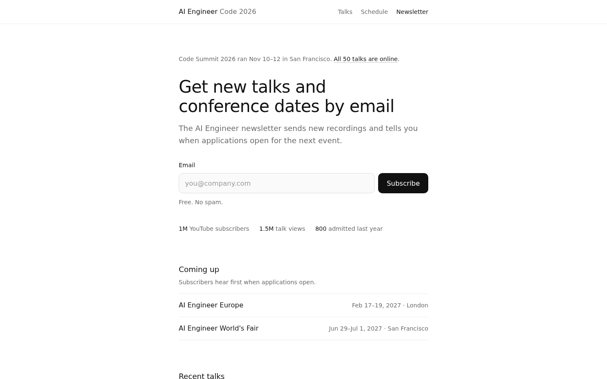

# AIE Code Summit 2026: newsletter signup mockup

A static redesign of https://ai.engineer/code/2026 with one goal: get visitors to
join the AI Engineer newsletter. Open `index.html` in a browser. There is no build
step and the page makes no network requests. CSS and JS are inline, and the font
is the system `ui-sans-serif` stack.

Design language follows alikhani.co: white background, `#111` ink, `#6b6b6b`
muted text, `#ededed` hairlines, weights 400/500, a 640px column, no eyebrows.

## Sources

- Findings: [docs/runs/ai.engineer/spec.md](../../../docs/runs/ai.engineer/spec.md)
  (goal "find the schedule and register to attend"; finding numbers below refer to it).
- Copy and numbers: `tests/evals/fixtures/aie-code-2026.html` (the committed crawl
  of the live page) plus https://ai.engineer/newsletter and https://ai.engineer/
  fetched 2026-11-13. `demo/aie-snapshot/` was not present on this branch, so it
  was not used.
- Every number on the page is from the live site: 1M YouTube subscribers, 1.5M
  talk views, 800 admitted last year, Europe Feb 17–19 2027 (London), World's Fair
  Jun 29–Jul 1 2027 (San Francisco). Talk titles and speakers are real Code 2026
  main-stage sessions.

## What the current page does to newsletter signups

The only newsletter path on /code/2026 is an "EMAIL UPDATES" link in the footer,
about 86% of the way down a 16-screen page (byte 172,650 of 200,306 in the
fixture), next to YouTube, X and LinkedIn. It opens a separate page in a new tab.
A visitor has to scroll past ~400 links and a still-open "Apply to attend" CTA
to find it.

## Finding → design change

| Spec finding | Change in the mockup |
| --- | --- |
| 10. No single dominant call to action above the fold (9 equal actions) | One filled button on the page: **Subscribe**. Everything else is a text link or a list row. The bottom "Subscribe" is outlined and scrolls back to the same form instead of adding a second form. |
| 9. Homepage requires 16 screens of scrolling | The page is ~1.8 screens at 1440×900. The form, its label and the proof row sit in the first screen on desktop and on a 390px phone. |
| 5. Post-event page still invites registration; the spec suggests "recordings, next-year waitlist" | The stale "Apply to attend" CTA is gone. The post-event path is the newsletter (hear when applications open) plus a link to the recordings. |
| 14. Contradictory pre/post-event messaging | One status line above the h1: "Code Summit 2026 ran Nov 10–12 in San Francisco. All 50 talks are online." The upcoming events list carries the future dates, so the past event and the next ones never share a sentence. |
| 3, 4. Browser runs never reached a confirm URL or saw a confirmation element | Submitting a valid email swaps the form for a visible `role="status"` confirmation ("You're subscribed", echoing the address) and sets the URL to `#confirmed`, so an assertion like `url-matches ".*confirm.*"` plus `element-visible #confirmation` can pass. Empty and malformed emails get an inline error under the field; no browser dialogs. |
| 12, 23. "How much does it cost?" has no answer | For this goal the cost question is about the newsletter, answered under the field: "Free. No spam." |
| 11, 16. 68-item nav, stacked nav bars | One header bar with three items: Talks, Schedule, Newsletter. |
| 2, 13, 17. Header Home/Schedule route to World's Fair 2025 | The site ID links to /code/2026, Schedule to /code/2026/schedule, Talks to /code/2026/talks. No cross-event links in the header. |
| 6, 22. Trunk test: missing site ID, page name, you-are-here | Site ID ("AI Engineer Code 2026") in the header, page name in the h1 and `<title>`, and `aria-current="page"` on Newsletter, shown in ink and weight 500. Search is left out on purpose: it competes with the one action this page exists for. |
| 15. Repeated strings and binary text | No repeated labels, no decorative tokens. Each label appears once. |
| 18. Generic "button" labels; developer links in primary nav | The button reads "Subscribe" and the field has a visible `<label>`. The llms.txt link moves to the footer next to YouTube and X. |
| 19, 20, 21. Broken heading outline; largest text isn't the h1 | Exactly one h1, which is the largest text on the page; two h2s below it. |
| 8. ~400 links compete for attention | 13 links total: 4 in the header, 3 talks, 3 in the footer, and 3 in the body. |

## Interaction details

- Field: `type="email"`, `autocomplete="email"`, `inputmode="email"`, 16px text so
  iOS doesn't zoom, 48px tall touch targets. On phones the button goes full width
  under the field.
- Validation runs on submit only; the error clears as soon as you type.
- Confirmation fades and rises 6px over 280ms; `prefers-reduced-motion` gets an
  opacity-only fade. Buttons scale to 0.97 on press. Hover styles are gated behind
  `(hover: hover)`.
- "Use a different email" restores the form with the old address selected.
- Without JS the form submits as a GET to https://ai.engineer/newsletter, the
  existing signup page.

## Not real

The mockup does not send email anywhere. A production version would post to the
newsletter provider behind https://ai.engineer/newsletter. Whether that provider
uses double opt-in is unknown, so the confirmation says "You're subscribed"
rather than "Check your inbox"; change it if double opt-in is on.
